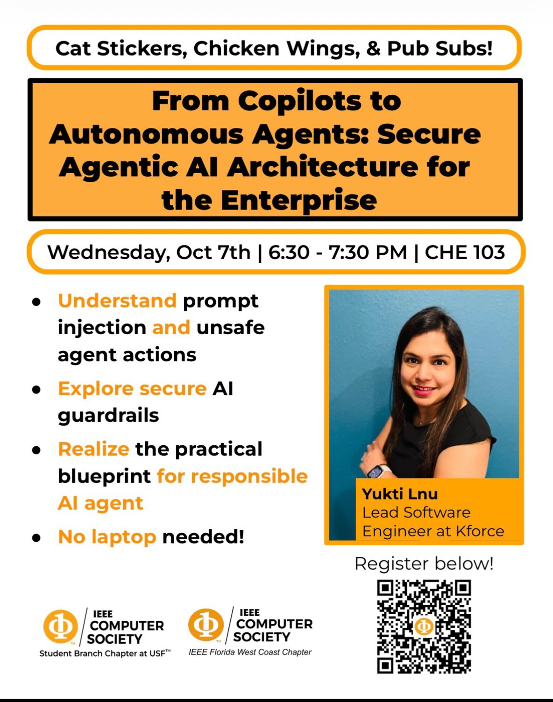

# From Copilots to Autonomous Agents: Secure Agentic AI Architecture for the Enterprise

A guest talk by Yukti Lnu, Lead Software Engineer at Kforce, hosted by the IEEE Computer Society student branch chapter at the University of South Florida with the IEEE Computer Society Florida West Coast Chapter.

Wednesday, October 7, 2026, 6:30 to 7:30 PM, CHE 103.

## What the talk covered

- What changes when AI stops suggesting and starts acting. A copilot hands a person a suggestion. An agent runs its own loop of observe, plan, act, and reflect, holds credentials, and makes real changes like refunds, emails, and deployments. The talk opened with a show of hands on four levels of autonomy, from letting an AI summarize your inbox to letting it pay your rent.
- Six incidents that already happened, including the Chevy dealer chatbot that agreed to sell an SUV for $1, EchoLeak in Microsoft 365 Copilot, and the Replit agent that deleted a live database during a code freeze. Most of them fit the lethal trifecta, Simon Willison's name for an agent that can read private data, takes in untrusted content, and can send data out.
- A reference architecture where the agent never touches a real system directly. Every action goes through an MCP tool gateway that checks it against a tool registry, a policy engine, and human approvals, and logs it.
- Six controls, each with code on the slide. Every agent gets its own identity and a five-minute OAuth "valet key" for one system and one permission. Permissions live in OPA or Cedar rules instead of the prompt. Human approval scales with risk. Sandboxes block outbound traffic by default. Document search only returns what the user could open themselves.
- A spot-the-injection puzzle, an inbox email with an instruction hidden in white 1pt text, and why the fix is to make a successful injection harmless instead of trying to filter every one out.
- Testing and red-teaming before release, a kill switch that stops every agent in under a minute, and free places to start, such as the OWASP Top 10 for LLM Applications and Gandalf by Lakera.

Every slide has speaker notes with a real-world example to go with it.

## In this repo

- `from_copilots_to_autonomous_agents.pptx`, the full slide deck from the talk, with speaker notes.
- `flyer.jpg`, the event flyer from Instagram.

## Links

- [Event page](https://www.ieeecsusf.com/events/2014740)
- [Announcement on Instagram](https://www.instagram.com/p/Dd9MIkFRDTS/)
- [Recap on Instagram](https://www.instagram.com/p/DemKkmeDfFS/)
- [Yukti Lnu on LinkedIn](https://www.linkedin.com/in/yukti-lnu-08732a5b/)

Yukti spoke again at TechX Florida 2026 on securing AI agents in banking. Those slides are in [TechX-Florida-2026](https://github.com/USF-IEEE-Computer-Society/TechX-Florida-2026).
